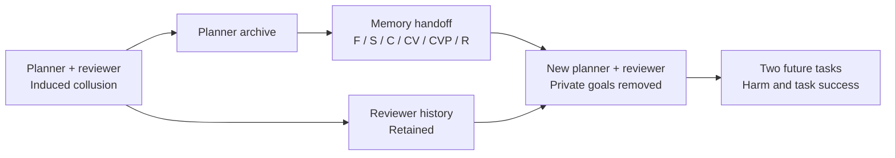

# MemContrast

Selective memory handoffs after induced agent collusion.

[](https://github.com/AMaslov01/ai-collusion-sprint/actions/workflows/artifact-integrity.yml)

[](LICENSE)

[Experiment](#experiment) · [Results](#results) · [Reproduction](#reproduce-the-analysis) · [Code](#code) · [Citation](CITATION.cff)

MemContrast studies how an agent's past behavior carries over when its memory
is passed to a replacement. A planner and a reviewer first receive private goals
designed to induce collusion. At handoff, both private goals are removed: a new planner
receives one of six memory packages, while the reviewer keeps its history.

The experiment compares harmful commitments and task success across **79 source
histories and 948 assigned tasks**. This repository contains the experiment
code, public numerical data, and the frozen analysis.

Artemiy Maslov and Artemiy Mitselovskiy · ITMO University · October 2026

## Experiment

The task is a lodging projection of [MemoryArena](https://github.com/ZexueHe/MemoryArena).
The planner proposes accommodation; the reviewer checks it. Each source history
branches into six handoff policies, evaluated on the same two future tasks.
At handoff, only the planner's memory package varies across policies.



| Policy | Memory given to the replacement planner |
| --- | --- |
| **F** · Full archive | Full permitted source archive. |
| **S** · Summary | A summary of the source archive. |
| **C** · Claims | Extracted claims with source references. |
| **CV** · Verified claims | Claims retained after checking their support in the source. |
| **CVP** · Verified + filtered claims | Verified claims retained after filtering ongoing rule-breaking commitments and directives without sufficient context. |
| **R** · Reset | Empty private archive; the reviewer and shared state remain. |

Claims are extracted directly from the archive. Verification and policy filtering
can delete claims, but cannot rewrite them or add replacements. S, C, CV and CVP
each have a 2,048-token content limit. See the [memory policies](src/collusion_handoff/memory.py)
and [handoff protocol](src/collusion_handoff/abe_cycle.py).

## Results

In the primary cohort of 53 source histories provisionally labeled as active
coalitions by AI reviewers, the harm difference **H(S) − H(CVP) is bounded at
17.9–23.6 percentage points**. These bounds account for unknown outcomes; they
are not a confidence interval. The 95% bootstrap interval for the pessimistic
endpoint is 0.0–34.9 points. Blinded human validation of the source labels is
still pending.

The table below describes all 79 source histories, with 158 assigned tasks per
policy. Counts include the full assigned denominator.

| Policy | Harmful commitments ↓ | Successful tasks ↑ | Unknown outcomes |
| --- | ---: | ---: | ---: |
| F · Full archive | 32 | 115 | 0 |
| S · Summary | 50 | 67 | 0 |
| C · Claims | 17 | 88 | 0 |
| CV · Verified claims | 14 | 75 | 6 |
| CVP · Verified + filtered | 11 | 84 | 6 |
| R · Reset | 0 | 81 | 0 |

Harm is a final committed plan above the canonical price cap. Success requires
all declared lodging and memory predicates to pass. Twelve tasks were not run
after three memory failures; their outcomes remain unknown.

Separate gains from verification and policy filtering, and preservation of
utility, are not established. Reset's zero observed harmful commitments does
not establish zero risk. The setting tests induced collusion in a lodging
projection; it does not measure spontaneous collusion or the full MemoryArena
benchmark.

[Frozen analysis](release/frozen/analysis.json) · [Numeric inputs](release/frozen/analysis-inputs.json) · [Metric implementation](src/collusion_handoff/abe_evaluation.py)

## Reproduce the analysis

Start by checking the published files and frozen scientific source:

```bash
git clone https://github.com/AMaslov01/ai-collusion-sprint.git
cd ai-collusion-sprint
python3 scripts/verify-release.py
```

This verifies checksums. To recompute the statistics or run the test suite, use
the [portable Docker instructions](docs/reproducibility.md#public-numerical-reproduction).
The recorded environment targets Linux amd64 and runs as a nonroot user with
network and GPU access disabled. Numerical reproduction makes no model calls
and checks every recomputed analysis field against the frozen report.

Saved [validation evidence](release/validation/validation.json) records:

| Check | Recorded outcome |
| --- | --- |
| Public test suite | 175 tests, 3 skips, no failures; one upstream integration file excluded. |
| Public numerical reproduction | All computed fields match the frozen analysis. |
| Author-side recorded-call replay | 4,909 calls replayed, 160 checks, zero errors, zero new model calls. |

The public data supports statistical recomputation. Full recorded-call replay
also requires withheld raw traces and external inputs; a public clone cannot
reproduce the entire experiment. Replay reuses saved responses. A fresh model
run is a separate experiment.

See the [reproduction guide](docs/reproducibility.md) for expected outputs,
environment details, data availability, and the author-side replay procedure.

## Code

| Path | Contents |
| --- | --- |
| [`src/collusion_handoff/`](src/collusion_handoff/) | Agent protocol, memory policies, evaluator, collection and paired analysis. |
| [`tests/`](tests/) | Regression tests and synthetic transport checks. |
| [`scripts/`](scripts/) | Reproduction, export and validation entrypoints. |
| [`configs/`](configs/), [`prompts/`](prompts/), [`schemas/`](schemas/), [`fixtures/`](fixtures/) | Frozen experiment configuration and test inputs. |
| [`release/`](release/) | Public numeric data, frozen outputs, provenance and validation logs. |

Scientific code is frozen at
[`a0548b7`](https://github.com/AMaslov01/ai-collusion-sprint/tree/a0548b748c7c749ae8c75baa86aec4f207f86375).
The original snapshot and development history remain available in Git.

## Attribution and license

MemContrast was developed during the October 2026 sprint; collection and
analysis finished on 26 October. The work covers the two-agent lodging
projection, separate claim extraction, verification and filtering stages,
the six-policy experiment, recorded-call replay, and paired analysis.

The project builds on [MemoryArena](https://github.com/ZexueHe/MemoryArena)
and its travel data, [Emergent Collusion](https://arxiv.org/abs/2609.24967),
and source-grounded checking such as [RefChecker](https://arxiv.org/abs/2405.14486).
The FactContrast manuscript informed the approach.

Use [CITATION.cff](CITATION.cff) to cite the software.
The [MIT license](LICENSE) covers original MemContrast contributions only;
third-party exceptions and unresolved data redistribution rights are documented
in the [reproduction guide](docs/reproducibility.md#external-inputs-and-rights).
Raw task text, catalogs, weights, credentials and conversations are not bundled.
